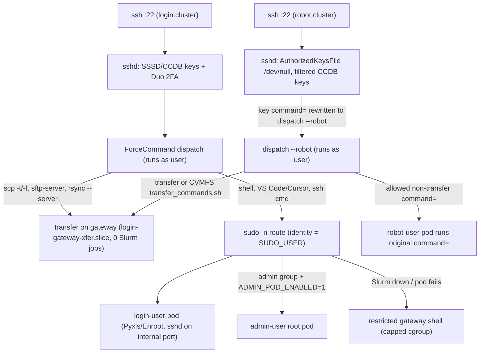

# slurm-login-pods

[](./LICENSE)
[](https://slurm.schedmd.com/)
[](./login-gateway/)
[](./agent-guardrails/)

> **Persistent per-user Slurm login pods, instant gateway file transfers, and Alliance-standard MFA automation gateways.**
>
> *Isolates interactive shells, IDEs, and AI coding agents into cgroup-bounded Enroot pods — while `scp`, `sftp`, and `rsync` run immediately on the gateway with zero Slurm jobs.*

*Developed at the [University of Alberta Research Computing Group](https://www.ualberta.ca/en/information-services-and-technology/research-computing/index.html) / [AMII](https://www.amii.ca/) for [Digital Research Alliance of Canada](https://alliancecan.ca/) HPC clusters, and adaptable to any Slurm + Pyxis/Enroot site.*

**Maintained by:** Rahim Khoja ([khoja1@ualberta.ca](mailto:khoja1@ualberta.ca)) and Karim Ali ([kali2@ualberta.ca](mailto:kali2@ualberta.ca))

[Description](#-description) · [Architecture](#-architecture) · [Options](#-configuration-options) · [Install](#-quick-install) · [Robot Keys](#-robot-automation-keys) · [Docs](#-documentation) · [Changelog](./CHANGELOG.md) · [Support](#-support)

---

## 📖 Description

Shared HPC login nodes suffer when one researcher's build, VS Code language server, or AI coding agent exhausts CPU or RAM for everyone else. Moving every SSH connection blindly into a Slurm job solves noisy neighbors, but breaks `scp`/`rsync` latency, SSH multiplexing, X11 forwarding, and MFA-exempt automation keys.

`slurm-login-pods` turns standard Alliance login (`login.<cluster>`) and automation (`robot.<cluster>`) gateways into thin SSH routers backed by persistent per-user **Pyxis + Enroot** pods:

- **One persistent pod per user (`login-<user>`):** Starts automatically on first SSH login, runs an unprivileged in-container `sshd` on an ephemeral high port with host-key pinning, and stays alive (`7-00:00:00` by default) so subsequent terminals, `tmux`, VS Code / Cursor / JetBrains Remote-SSH, X11 (`-X`/`-Y`), agent forwarding (`-A`), and Open OnDemand Web Shell attach in milliseconds.
- **Zero-wait file transfers:** `ForceCommand` classifies `SSH_ORIGINAL_COMMAND` as the user before touching Slurm. `scp`, `sftp`, `rsync --server`, `rrsync`, and Alliance CVMFS `transfer_commands.sh` wrappers execute directly on the gateway inside `login-gateway-xfer.slice` — zero Slurm jobs queued.
- **Alliance MFA automation standard (`robot.<cluster>`):** Enforces `AuthorizedKeysFile /dev/null`, CCDB/LDAP keys only (`sss_ssh_authorizedkeys.filter`), `mfa-automation-users` group membership, mandatory `restrict,from="...",command="..."`, public-IP `/24` (IPv4) and `/64` (IPv6) source bounds, and small `robot-<user>` pods with no MOTD and no AI guardrails.
- **Built-in `cluster-status` & AI `agent-guardrails`:** Ships a generic, pod-aware login status banner (ported from `vulcan-status`, cached inside pod `/tmp/cluster-status`) and system-wide guardrails + Alliance HPC skills across Claude Code, Codex, OpenCode, Gemini CLI, Antigravity, Pi, and Cursor (ported from [`drac-agent-skills`](https://github.com/ualberta-rcg/drac-agent-skills)).

---

## 🏗 Architecture



### Repository layout

```text
slurm-login-pods/
  images/user/      Ubuntu 24.04 user pod image, entrypoints, login-pod, sq, seff, diskusage_report
  images/admin/     Optional privileged admin-<user> root pod image (sudo + libpam-sss)
  login-gateway/    dispatch, route, spawn, stop, classify-transfer, robot key filter, sshd/PAM/systemd
  slurm/            login partition, pyxis.conf, job_container.conf, job_submit.lua exemption snippets
  status/           Generic pod-aware cluster-status banner + systemd cache baker
  agent-guardrails/ System-wide HPC guardrails & 5 Alliance skills (no API keys or backend configs)
  deploy/warewulf/  Secret-free Warewulf 4 overlay renderer (render-overlays.sh)
  deploy/standalone/Standalone gateway installer (install.sh --role {login,robot})
  deploy/ansible/   Node prep, MOTD cleanup, and AI agent CLI installation playbooks
  docs/             Architecture, flows, transfers, robot rules, Slurm, deployment, security, hooks
  tests/            Unit & integration tests (robot filter, CIDR rules, transfers, dispatcher, PII scan)
```

---

## ⚙️ Configuration Options

All site tunables live in `/etc/login-gateway/login-gateway.conf` (template at [`login-gateway/etc/login-gateway/login-gateway.conf.example`](./login-gateway/etc/login-gateway/login-gateway.conf.example)):

| Variable | Default | Description |
|---|---|---|
| `CLUSTER_NAME` | `$(hostname -s)` | Short cluster slug exported as `CC_CLUSTER` and used in pod hostnames |
| `PARTITION` | `login` | Slurm partition hosting `login-<user>` and `robot-<user>` pods (`OverSubscribe=FORCE`) |
| `IMAGE_PATH` | `/cache/slurm-login-pods.sqsh` | Shared SquashFS user pod image imported via `enroot import` |
| `LOGIN_CPUS` / `LOGIN_MEM` / `LOGIN_WALLTIME` | `4` / `4G` / `7-00:00:00` | Interactive user pod slice and lifetime |
| `ROBOT_MODE` | `dedicated` | `dedicated` (`robot.<cluster>` node/IP) or `port22` (shared port 22 via key marker) |
| `ROBOT_GROUP` | `mfa-automation-users` | POSIX group authorized to use MFA-exempt automation keys |
| `ALLOW_HOME_ROBOT_KEYS` | `0` | Keep `0` on Alliance clusters so keys come strictly from CCDB/LDAP |
| `ROBOT_CPUS` / `ROBOT_MEM` / `ROBOT_WALLTIME` | `2` / `1G` / `02:00:00` | Lightweight automation pod slice |
| `TRANSFER_FASTPATH` | `1` | Run validated `scp`/`sftp`/`rsync` directly on the gateway in `login-gateway-xfer.slice` |
| `POD_HOSTNAME_TEMPLATE` | `%c-%m-%u` | Per-pod UTS hostname (`%c` cluster, `%m` mode, `%u` user, `%n` node) |
| `SLURM_DOWN_FALLBACK` | `restricted-shell` | `restricted-shell` (capped cgroup on gateway when `slurmctld` is down) or `deny` |
| `ADMIN_POD_ENABLED` | `0` | Route `GATEWAY_BYPASS_GROUPS` into `admin-<user>` root pods instead of host shell |
| `SHIM_USERS` | `""` | Service accounts allowed to resolve synthetic identities via `/etc/login-gateway/hooks/identity` |

---

## 🚀 Quick Install

### Option A: Warewulf 4 overlays

Render clean, secret-free overlays on your management node and layer your site overlay on top:

```bash
deploy/warewulf/render-overlays.sh --output-dir /tmp/ww-overlays

# Import into Warewulf overlays (login-gateway, cluster-status, agent-guardrails)
# and place your <site-overlay> last in the node profile so site config wins.
```

Full step-by-step canary workflow: [`docs/deploy-warewulf.md`](./docs/deploy-warewulf.md).

### Option B: Standalone gateway host

```bash
# Interactive login gateway (login.<cluster>)
sudo deploy/standalone/install.sh --role login --with-status --with-guardrails
sudo sshd -t && sudo systemctl reload ssh

# Dedicated MFA automation gateway (robot.<cluster>)
sudo deploy/standalone/install.sh --role robot
sudo sshd -t && sudo systemctl reload ssh
```

Full standalone setup: [`docs/deploy-standalone.md`](./docs/deploy-standalone.md).

---

## 🤖 Robot Automation Keys

On `robot.<cluster>`, `AuthorizedKeysFile` is `/dev/null` and keys are fetched exclusively from CCDB/LDAP through `sss_ssh_authorizedkeys.filter`. Every key must belong to a member of `mfa-automation-users` and specify **all three** of `restrict`, `from="..."` (public IPv4 `/24` or narrower, or public IPv6 `/64` or narrower), and `command="..."`:

```text
# Automated rsync / scp / sftp via the Alliance CVMFS transfer wrapper (runs on gateway fast-path)
restrict,from="198.51.100.0/24",command="/cvmfs/soft.computecanada.ca/custom/bin/computecanada/allowed_commands/transfer_commands.sh" ssh-ed25519 AAAA...

# Scoped single-directory rsync via rrsync (runs on gateway fast-path)
restrict,from="198.51.100.42",command="rrsync -ro /project/def-pi/shared-dataset" ssh-ed25519 AAAA...

# Automated Slurm workflow trigger (runs inside a 2-CPU / 1G robot-<user> pod)
restrict,from="198.51.100.10,2001:db8:abcd:1234::/64",command="/cvmfs/soft.computecanada.ca/custom/bin/computecanada/allowed_commands/allowed_commands.sh" ssh-ed25519 AAAA...
```

Keys missing `restrict`, missing `command=`, using broad wildcards (`*`, `198.51.*`), or specifying RFC1918/private CIDRs are rejected and logged. Details: [`docs/robot-automation.md`](./docs/robot-automation.md).

---

## 📚 Documentation

- [Architecture & Pod Lifecycle](./docs/architecture.md)
- [Connection Flows (Shell, VS Code/IDEs, X11, OOD, Robot)](./docs/connection-flows.md)
- [Gateway File-Transfer Fast-Path (`scp`, `sftp`, `rsync`)](./docs/file-transfers.md)
- [Robot / MFA Automation Gateway Standard](./docs/robot-automation.md)
- [Admin Root Pod (`admin-<user>`)](./docs/admin-pod.md)
- [Slurm, Pyxis, Enroot & `job_submit.lua` Configuration](./docs/slurm-config.md)
- [Deploying with Warewulf 4](./docs/deploy-warewulf.md)
- [Deploying on Standalone Hosts](./docs/deploy-standalone.md)
- [Security Model & Containment Boundaries](./docs/security-model.md)
- [Site Customization (Hooks, Branding, Agent Site Notes)](./docs/site-customization.md)
- [Troubleshooting Field Guide](./docs/troubleshooting.md)
- [Secrets & Runtime Injection Policy](./SECRETS.md)

For AI agent backend configuration templates (hosted cluster LLM endpoints, Z.AI, DeepSeek, Kimi) and optional scientific community skills, see [`drac-agent-skills`](https://github.com/ualberta-rcg/drac-agent-skills).

---

## 🔗 References

- [Digital Research Alliance of Canada — Automation / Multifactor Authentication](https://docs.alliancecan.ca/wiki/Automation_in_the_context_of_multifactor_authentication)
- [Digital Research Alliance of Canada — Technical Documentation](https://docs.alliancecan.ca/)
- [NVIDIA Pyxis SPANK Plugin](https://github.com/NVIDIA/pyxis) & [NVIDIA Enroot](https://github.com/NVIDIA/enroot)
- [`drac-agent-skills` — Alliance Cluster Skills & Guardrails](https://github.com/ualberta-rcg/drac-agent-skills)
- [`vulcan-status` — Slurm Login Status Banner](https://github.com/ualberta-rcg/vulcan-status)

---

## 🤝 Support

Many Bothans died to bring us this information. This project is provided as-is, but reasonable questions may be answered based on coffee intake or mood. ;)

Feel free to open an issue or email **[khoja1@ualberta.ca](mailto:khoja1@ualberta.ca)** or **[kali2@ualberta.ca](mailto:kali2@ualberta.ca)** for U of A or Alliance deployments.

## 📜 License

This project is released under the **MIT License** — use it, modify it, distribute it, include it in proprietary software. Keep the copyright notice. That's it.

**Full license text:** [MIT License](./LICENSE)

## 🧠 About University of Alberta Research Computing

The [Research Computing Group](https://www.ualberta.ca/en/information-services-and-technology/research-computing/index.html) supports high-performance computing, data-intensive research, and advanced infrastructure for researchers at the University of Alberta and across Canada.

We help design and operate compute environments that power innovation — from AI training clusters to national research infrastructure.
